<a href="https://www.fisch.ing"><picture>
  <source media="(prefers-color-scheme: dark)" srcset="assets/title-dark.svg">
  
</picture></a>

Hi, I'm Waysel. I make small, slightly odd things: a fishing game that grew out of a joke fish website, a system fetch with a swimming fish, and a TV home screen from Night City. I'm from Germany, so Deutsch geht auch.

<a href="https://www.fisch.ing"><picture>
  <source media="(prefers-color-scheme: dark)" srcset="assets/dex-fischen-dark.svg">
  
</picture></a>
<a href="https://github.com/Waysel07/fishfetch"><picture>
  <source media="(prefers-color-scheme: dark)" srcset="assets/dex-fishfetch-dark.svg">
  
</picture></a>
<a href="https://github.com/Waysel07/cyberhome"><picture>
  <source media="(prefers-color-scheme: dark)" srcset="assets/dex-cyberhome-dark.svg">
  
</picture></a>
<a href="https://github.com/Waysel07/terminal-glass-glow"><picture>
  <source media="(prefers-color-scheme: dark)" srcset="assets/dex-glass-dark.svg">
  
</picture></a>

Pixel lettering: <a href="https://fonts.google.com/specimen/Press+Start+2P">Press Start 2P</a> by CodeMan38 (SIL OFL 1.1), drawn to pixels by <code>assets/gen.py</code>.
