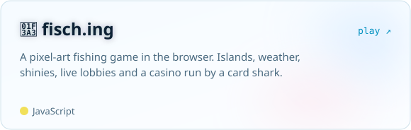
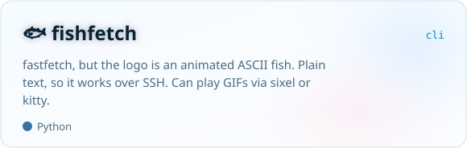
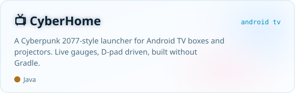
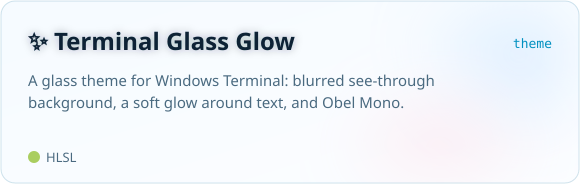

<picture>
  <source media="(prefers-color-scheme: dark)" srcset="assets/header-dark.svg">
  
</picture>

I make small, slightly odd things that I want to exist: a fishing game that started as a joke website, a system fetch that shows a swimming fish, and a TV home screen that looks like it belongs in Night City.

### Things I made

<a href="https://www.fisch.ing"><picture><source media="(prefers-color-scheme: dark)" srcset="assets/card-fisch-dark.svg"></picture></a>
<a href="https://github.com/Waysel07/fishfetch"><picture><source media="(prefers-color-scheme: dark)" srcset="assets/card-fishfetch-dark.svg"></picture></a>
<a href="https://github.com/Waysel07/cyberhome"><picture><source media="(prefers-color-scheme: dark)" srcset="assets/card-cyberhome-dark.svg"></picture></a>
<a href="https://github.com/Waysel07/terminal-glass-glow"><picture><source media="(prefers-color-scheme: dark)" srcset="assets/card-glass-dark.svg"></picture></a>

### Right now

- 🎣 Adding new islands, fish and multiplayer features to **[Fischen!](https://www.fisch.ing)**, the game on fisch.ing

### Usually reaching for

`JavaScript` `TypeScript` `Python` `Java` `HLSL` · `Canvas` `React` `Vercel` · `Android` `Windows Terminal` `fastfetch`
