<a href="https://www.fisch.ing"><picture>
  <source media="(prefers-color-scheme: dark)" srcset="assets/title-dark.svg">
  
</picture></a>

Hi, I'm Waysel from Germany 🇩🇪. I make small, odd things.

- 🎣 **[Fischen!](https://www.fisch.ing)**: a pixel-art fishing game in your browser
- 🐟 **[fishfetch](https://github.com/Waysel07/fishfetch)**: fastfetch, but the logo is a swimming fish
- 📺 **[CyberHome](https://github.com/Waysel07/cyberhome)**: a Cyberpunk 2077-style launcher for Android TV
- ✨ **[Terminal Glass Glow](https://github.com/Waysel07/terminal-glass-glow)**: a glass theme for Windows Terminal
