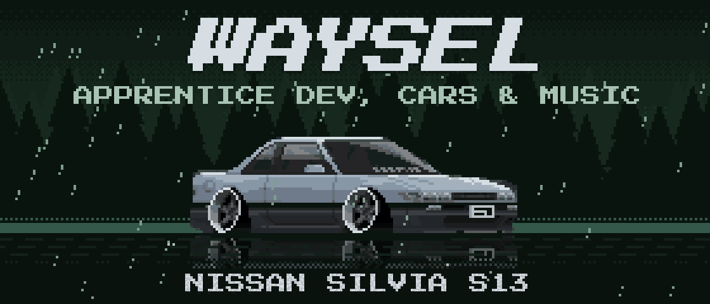

Hi, I'm Waysel 👋 I'm an apprentice software developer from Germany 🇩🇪. 
When I'm not coding, I'm into 🚗 cars and 🎧 music.

### Things I've built

🎣 **[Fischen!](https://www.fisch.ing)**: a pixel-art fishing game you play in the browser 
🎧 **[rustpods](https://github.com/Waysel07/rustpods)**: AirPods on Linux, with battery popup, ear detection and stem controls 
🐟 **[fishfetch](https://github.com/Waysel07/fishfetch)**: fastfetch, but the logo is a swimming fish 
📺 **[CyberHome](https://github.com/Waysel07/cyberhome)**: a Cyberpunk 2077-style launcher for Android TV 
✨ **[Terminal Glass Glow](https://github.com/Waysel07/terminal-glass-glow)**: a glass theme for Windows Terminal

